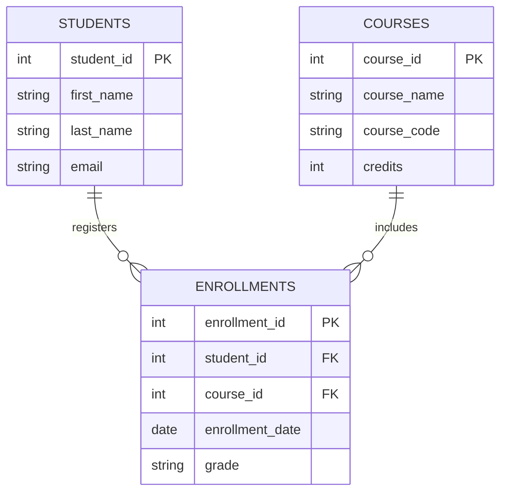

# python-full-stack-task

## About the Project

This repository contains Python Full Stack Development practice tasks completed from Day 1 to Day 4.

The tasks cover Python programming fundamentals, Object-Oriented Programming (OOP), advanced Python concepts, and basic record management programs.

## Technologies Used

- Python 3
- GitHub

## Day 1 – Introduction to Full Stack Development

Topics covered:
- Introduction to Full Stack Development
- Frontend, Backend, and Database
- Client-Server Architecture
- Technologies used in Full Stack Applications

## Day 2 – Python Programming Fundamentals

| File Name | Description |
|---|---|
| `even_odd.py` | Checks whether a number is even or odd |
| `largest_number.py` | Finds the largest of three numbers |
| `factorial.py` | Calculates the factorial of a number |
| `prime_number.py` | Checks whether a number is prime |
| `reverse_number.py` | Reverses a number |
| `multiplication_table.py` | Prints the multiplication table |

## Day 3 – Object-Oriented Programming (OOP)

| File Name | Description |
|---|---|
| `student_employee.py` | Student and Employee classes |
| `inheritance.py` | Demonstrates inheritance and polymorphism |
| `student_manager.py` | Console-based Student Management Application |

OOP concepts covered:
- Classes and Objects
- Constructors
- Encapsulation
- Inheritance
- Method Overriding
- Polymorphism

## Day 4 – Advanced Python Programming

| File Name | Description |
|---|---|
| `record_processing.py` | Searches and sorts student records |
| `validate_marks.py` | Validates marks and handles exceptions |
| `json_records.py` | Reads and writes records using JSON |
| `comprehensions.py` | Demonstrates list and dictionary comprehensions |

Topics covered:
- Lists, Tuples, Sets, and Dictionaries
- Functions
- Searching and Sorting
- Exception Handling
- JSON File Handling
- List and Dictionary Comprehensions

## How to Run the Programs

1. Install Python 3 on your computer.
2. Download or clone this repository.
3. Open the project folder in a terminal.
4. Run any Python program using:

```bash
python even_odd.py
```

Replace `even_odd.py` with the name of the program you want to run.

## Learning Objectives

- Understand Python programming fundamentals.
- Practice Object-Oriented Programming concepts.
- Work with collections and functions.
- Learn input validation and exception handling.
- Perform basic record processing and JSON file operations.

## Author

Python Full Stack Development Practice Repository


# Day 6 — HTML Fundamentals

## Topics Covered

- **Introduction to HTML:** HTML is used to create and structure webpages.
- **HTML Document Structure:** Every HTML page contains basic elements like `html`, `head`, and `body`.
- **Headings and Paragraphs:** Headings and paragraphs are used to display titles and text.
- **Links and Images:** Links connect webpages, and images display pictures on a webpage.
- **Lists and Tables:** Lists organize information, while tables display data in rows and columns.
- **Forms and Input Fields:** Forms collect user information using different input fields.
- **Semantic HTML Elements:** Semantic elements like `header`, `main`, and `footer` give meaning to webpage content.

## Tasks Completed

### 1. Personal Profile Webpage
Created a personal webpage to display personal information, education, skills, and contact details using HTML elements.

### 2. Student Registration Form
Created a registration form to collect student details such as name, email, date of birth, gender, and course.

### 3. Student Records Table
Created an HTML table to display student records, including student ID, name, course, and email.

### 4. Semantic HTML
Used semantic HTML elements to organize webpage content and improve its structure.

## Expected Output
- A personal profile webpage displaying personal information.
- A student registration form for collecting student details.

## Technologies Used
HTML, Notepad, and Web Browser.

## How to Run
Open the HTML files in a web browser to view the webpages.

# Day 7 - CSS Fundamentals

## Project Description
This project demonstrates CSS styling and responsive design for HTML webpages.

## Topics Covered
- **Introduction to CSS:** Learned how CSS is used to style HTML webpages.
- **CSS Selectors and Properties:** Used selectors to apply styles to HTML elements.
- **Colors and Backgrounds:** Added colors and background designs to webpages.
- **Margin and Padding:** Used spacing to improve webpage layout.
- **CSS Box Model:** Learned how content, padding, border, and margin work together.
- **Flexbox:** Arranged webpage cards and elements using flexible layouts.
- **Responsive Web Design:** Made webpages suitable for mobile and desktop screens.

## Tasks Completed
- **Personal Profile Page:** Created and styled a personal profile webpage.
- **Student Registration Form:** Designed a registration form with input fields.
- **Navigation Bar:** Created links to navigate between webpages.
- **Flexbox Cards:** Arranged cards neatly using Flexbox.
- **Responsive Design:** Adjusted webpage layout for different screen sizes.

## Files Included
- **index.html:** Contains the personal profile webpage.
- **style.css:** Contains CSS styles for the webpages.
- **registration.html:** Contains the student registration form.

## How to Run
1. Open the project folder.
2. Double-click `index.html` to view the webpage in a browser.
3. Click the Registration link to open the registration form.

## Technologies Used
- **HTML5:** Used to create the structure of webpages.
- **CSS3:** Used to style and design webpages.


# Day 8 - JavaScript Fundamentals

## Topics
- Introduction to JavaScript
- Variables: var, let, and const
- Data types and operators
- Conditional statements and loops
- Functions
- Arrays and objects

## Programs
- Check even or odd numbers
- Print numbers using loops
- Perform basic calculations using functions
- Perform array operations
- Create and update object properties
- Find the largest number
- Calculate factorial

## How to Run
1. Open index.html in a web browser.
2. Press F12 and select Console.
3. View the JavaScript program outputs.

## Expected Output
Basic understanding of JavaScript fundamentals
and practice programs using conditions, loops,
functions, arrays, and objects.


# Day 9 - Advanced JavaScript

This project demonstrates advanced JavaScript concepts through an interactive Student Management System.

## Features
- Add students with their marks.
- Search students by name.
- Display student grades and class statistics.
- Practice DOM manipulation and event handling.
- Use map, filter, and reduce array methods.
- Demonstrate promises, async/await, and Fetch API.

## Technologies Used
- HTML
- CSS
- JavaScript

## How to Run
Open the index.html file in a web browser.

## Output
An interactive webpage that displays student details,
grades, and class statistics.


# Day 11 - React Student Registration Form

## Description
A React application for student course registration.

## Features
- Enter student name and email.
- Select a course.
- Validate required fields.
- Display submitted student details.
- Use the useState Hook for state management.
- Handle form submission with events.
- Use conditional rendering.

## Technologies Used
- React
- JavaScript
- HTML
- Vite

## How to Run
1. Install Node.js.
2. Download or clone this repository.
3. Open the project folder in a terminal.
4. Run npm install.
5. Run npm run dev.
6. Open the local URL shown in the terminal.

## Learning Outcomes
Learned functional components, state, controlled components,
event handling, form handling, and conditional rendering.


# Day 12 - React Routing

## Description
A multi-page React application using React Router.

## Pages
- Home: Welcome page.
- About: Application information.
- Students: Student list and dynamic student details.
- Contact: Contact information.
- 404: Displays when a page does not exist.

## Concepts Covered
- BrowserRouter
- Routes and Route
- Link and NavLink
- Client-side navigation
- Dynamic route parameters using useParams
- Not-found page

## How to Run
1. Install dependencies using npm install.
2. Start the development server using npm run dev.
3. Open the local URL shown in the terminal.


# Day 13 - Database Fundamentals

## Project: Student Management Database

### 1. Objective
To design a relational database for managing student details, courses, and student enrollments using PostgreSQL.

### 2. Introduction
A database is an organized collection of information. A relational database stores data in tables containing rows and columns. PostgreSQL is a relational database management system used to store and manage data.

### 3. Database Tables

#### Students Table
Stores personal information about students.

- `student_id` - Primary key that uniquely identifies each student.
- `first_name` - Student's first name.
- `last_name` - Student's last name.
- `email` - Student's unique email address.
- `phone` - Student's contact number.
- `date_of_birth` - Student's date of birth.

#### Courses Table
Stores information about available courses.

- `course_id` - Primary key that uniquely identifies each course.
- `course_name` - Name of the course.
- `course_code` - Unique code assigned to each course.
- `credits` - Number of credits for the course.

#### Enrollments Table
Connects students with their selected courses.

- `enrollment_id` - Primary key that uniquely identifies each enrollment.
- `student_id` - Foreign key referencing the Students table.
- `course_id` - Foreign key referencing the Courses table.
- `enrollment_date` - Date when the student enrolls.
- `grade` - Grade received by the student.

### 4. ER Diagram


# Student Management ER Diagram




### 5. Relationships

- One student can enroll in multiple courses.
- One course can have multiple students.
- The Enrollments table connects Students and Courses.
- Students and Enrollments have a one-to-many relationship.
- Courses and Enrollments have a one-to-many relationship.
- Students and Courses have a many-to-many relationship through Enrollments.

### 6. Primary Key and Foreign Key

- Primary Key (PK): Uniquely identifies each record in a table.
- Foreign Key (FK): Connects related tables and maintains referential integrity.

### 7. Technologies Used

- PostgreSQL
- SQL
- GitHub Markdown
- Mermaid ER Diagram / PNG image

### 8. Project Files

- `student_management.sql` - SQL commands to create the database tables.
- `database_design.md` - Detailed database design and field descriptions.
- `er_diagram.md` - ER diagram source code.
- `er_diagram.png` - ER diagram image.
- `README.md` - Project documentation.

### 9. How to Implement

1. Open a PostgreSQL environment.
2. Create a database named `student_management`.
3. Open and execute `student_management.sql`.
4. Verify that the Students, Courses, and Enrollments tables are created.
5. Review the ER diagram to understand the relationships.

### 10. Expected Output

A Student Management database design containing three related tables, primary keys, foreign keys, and a visual ER diagram.

### 11. Conclusion

This project demonstrates the fundamentals of relational databases, database design, primary keys, foreign keys, table relationships, PostgreSQL, and ER diagrams.


# Day 14 - SQL Fundamentals

## Objective
Learn SQL commands to create tables, insert records,
retrieve data, update information, and delete records.

## Topics Covered
- CREATE, ALTER, and DROP
- INSERT, UPDATE, and DELETE
- SELECT and WHERE
- ORDER BY and LIMIT
- Filtering records
- Constraints
- Primary and foreign keys
- JOIN operations

## Tasks Completed
- Created student, course, and enrollment tables.
- Inserted sample student and course records.
- Retrieved and filtered records.
- Sorted and limited query results.
- Updated student information.
- Deleted a selected enrollment.
- Practiced SQL JOIN queries.

## Expected Output
- Database tables created successfully.
- Sample records inserted successfully.
- SQL queries practiced successfully.
- Student and course details retrieved.
- Update and delete operations verified.

## Technology Used
PostgreSQL and SQL

## How to Run
1. Open a PostgreSQL-compatible SQL editor.
2. Create the tables using the SQL file.
3. Insert the sample records.
4. Execute the SELECT queries.
5. Verify the UPDATE and DELETE operations.


